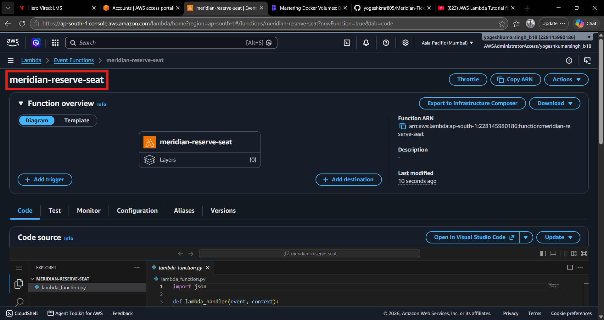
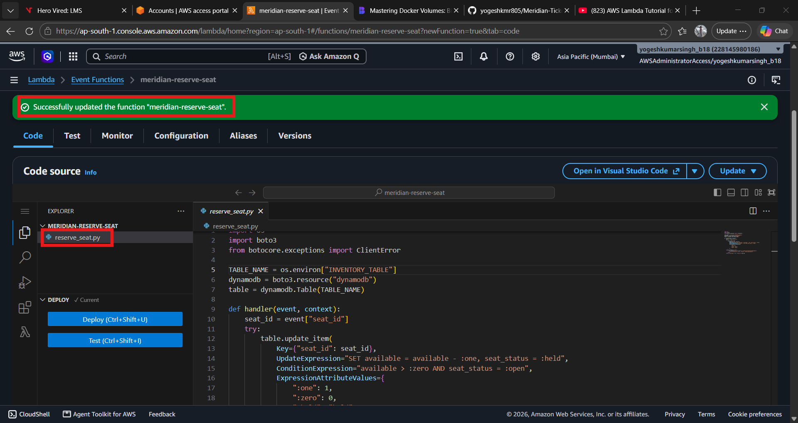
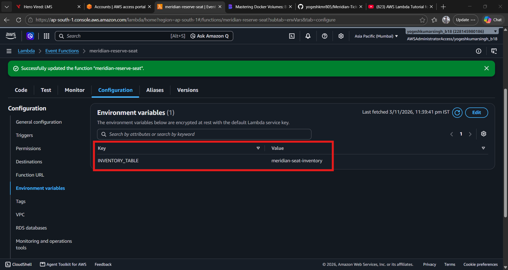
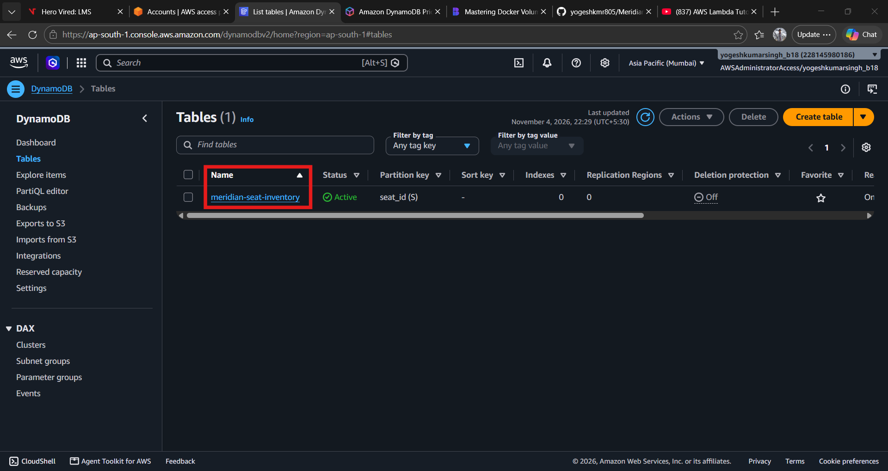
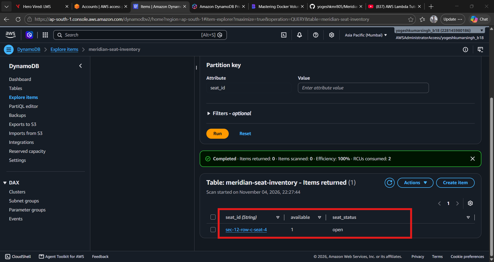
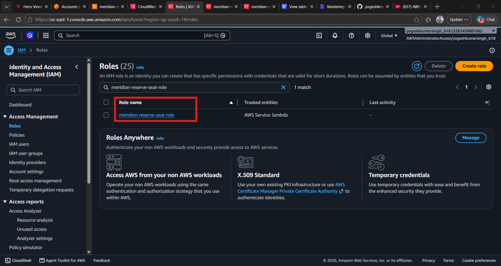
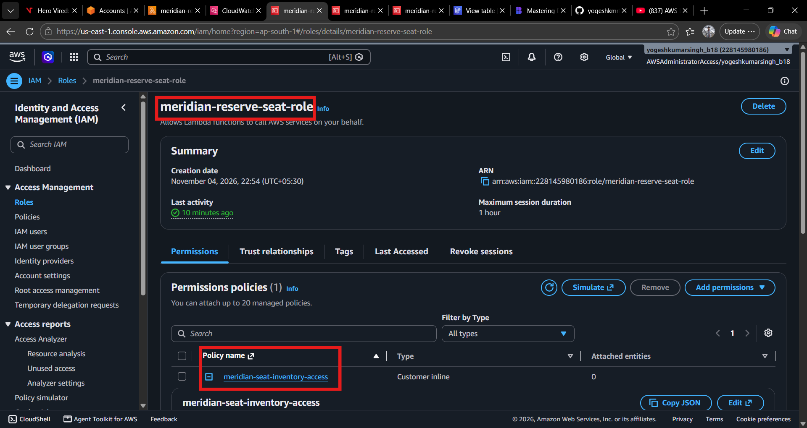
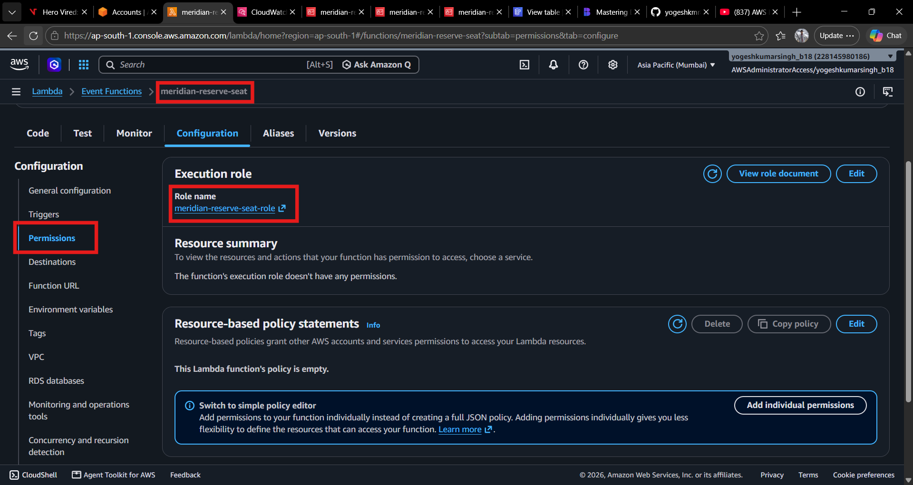
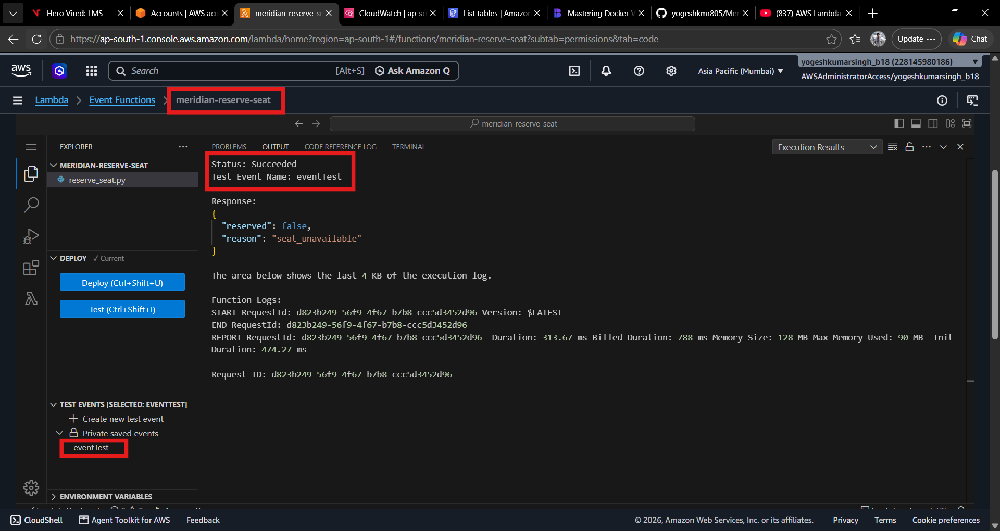

# Meridian Tickets: Seat Reservation Service

Meridian Tickets sells seats to concerts and stadium shows. Popular tours go on sale at exactly 10:00 AM local time, and demand arrives in a single burst within seconds of that moment.

This repository holds the seat-reservation path: the code that takes a fan's request to reserve seats and either confirms the reservation or returns an honest "sold out" response.

## Background

During a recent arena show sale, the reservation service failed within the first ninety seconds of the on-sale. The service ran on a fixed pool of EC2 instances behind a load balancer. CPU saturated almost immediately, and autoscaling took about four minutes to bring new capacity online. Thousands of fans received timeout errors instead of a clear sold-out message.

The requirements that came out of that incident:

- **Absorb spikes.** The reservation path must handle roughly 50x normal traffic within seconds of an on-sale opening.
- **Stay cheap when idle.** Most days nobody is buying tickets, so the service should cost close to nothing when there is no traffic.
- **Fail honestly.** When seats are gone, users get a clear sold-out response, not a timeout.

Serverless compute fits this combination of instant scale and near-zero idle cost, so the reservation function is implemented on AWS Lambda.

## Current Status

This project is in early development. The current focus is the reservation function itself, which is the first piece of the Lambda-based path. Load testing against a simulated on-sale burst and the surrounding infrastructure (API entry point, data store, and monitoring) are still to come.

## How It Works (Planned Design)

1. A client sends a reservation request for a show, a section, and a quantity of seats.
2. The reservation function checks seat availability and attempts to claim the seats atomically, so two requests can never sell the same seat.
3. On success, the function returns a confirmed reservation.
4. If the requested seats are no longer available, the function returns a sold-out response immediately instead of waiting on capacity.

Because each invocation is independent, Lambda can run many copies in parallel during a spike and scale back to zero afterward.

 ## Step-by-Step Implementation

 ### Step 1: Creating the Reservation Function
 - Added a Lambda function file `reserve-seats.py` that handles seat reservation requests. The function checks the availability of requested seats and attempts to reserve them atomically.

 - It uses a DynamoDB table to store seat availability and reservation status. The function ensures that no two requests can reserve the same seat by using conditional writes.

 - The function returns a confirmation response if the reservation is successful, or a sold-out response if the requested seats are no longer available.

 - Now save the Python handler as reserve_seat.py, then zip it.
    ```
    zip function.zip reserve_seat.py
    ```
### Step 2: Deploying the Lambda Function
- Create a new Lambda function naming `meridian-reserve-seat` in the AWS Management Console.

    Below is screenshot of the Lamda fucntion created: 
    
    

- Upload the `function.zip` file to the Lambda function.
    
    Below is screenshot of the Lamda function uploaded:

    

- Add below Environment Variable to the Lambda function:
    - `INVENTORY_TABLE` : Name of the DynamoDB table that holds seat availability and reservation status. 
    Value: `meridian-seat-inventory`

    Below is screenshot of the Environment Variable added to the Lamda function:

    

- Edit handler to `reserve_seat.handler` in the Lambda function configuration.
    ```
    aws lambda update-function-configuration \
    --function-name meridian-reserve-seat \
    --handler seat_reserve.handler
    ```
### Step 3: Setting Up DynamoDB Table
- Create a DynamoDB table named `meridian-seat-inventory` with a primary key of `seat_id` (string). This table will store the availability and reservation status of each seat.

    Below is screenshot of the DynamoDB table created:

    

- Create a sample item in the table to represent a seat.

    - Go to Table `meridian-seat-inventory` and click on "Create item".
    - Add below attributes for the item in json format:
        ```json
        {
        "seat_id": {
        "S": "sec-12-row-c-seat-4"
        },
        "available": {
            "N": "1"
        },
        "seat_status": {
            "S": "open"
        }
        }
        ```
    Below is screenshot of the sample item created in the DynamoDB table:

    

### Step 4: Create execution role for Lambda function
- Create a new IAM role named `meridian-reserve-seat-role`.
    
    Below is the screenshot of the IAM role created:

    
- Our Lambda function `meridian-reserve-seat` needs permission to read and write to the DynamoDB table `meridian-seat-inventory` and to write logs to CloudWatch. So we will attach below policy to the role.
    ```json
    {
    "Version": "2012-10-17",
    "Statement": [
        {
            "Sid": "SeatInventoryReadWrite",
            "Effect": "Allow",
            "Action": [
                "dynamodb:GetItem",
                "dynamodb:UpdateItem"
            ],
            "Resource": "arn:aws:dynamodb:<Region>:<Account_ID>:table/meridian-seat-inventory"
        },
        {
            "Sid": "BasicLogging",
            "Effect": "Allow",
            "Action": [
                "logs:CreateLogGroup",
                "logs:CreateLogStream",
                "logs:PutLogEvents"
            ],
            "Resource": "arn:aws:logs:<Region>:<Account_ID>:log-group:/aws/lambda/meridian-reserve-seat:*"
        }
        ]
    }
    ``` 
    Replace `<Region>` and `<Account_ID>` with your AWS region and account ID respectively.

- Attach the policy to the role `meridian-reserve-seat-role`.

    Below is screenshot of the policy attached to the IAM role:

    

- Assign the role `meridian-reserve-seat-role` to the Lambda function `meridian-reserve-seat`.
    
    - Go to the Lambda function `meridian-reserve-seat` in the AWS Management Console.
    - In the "Configuration" tab, click on "Permissions".
    - Under "Execution role", click on "Edit" and select the role `meridian-reserve-seat-role` from the dropdown menu.

    Below is screenshot of the role assigned to the Lamda function:

   

### Step 5: Testing the Lambda Function
- You can test the Lambda function by creating a test event in the AWS Management Console.

    - Go to the Lambda function `meridian-reserve-seat` in the AWS Management Console.
    - Click on "Test" and then "Configure test event".
    - Choose "Create new test event" and give it a name, e.g., `eventTest`.
    - In the "Event JSON" field, enter a sample reservation request in JSON format:
        ```json
        {
            "seat_id": "sec-12-row-c-seat-4"
        }
        ```
    - Click on "Create" to save the test event.
    - Click on "Test" again to invoke the Lambda function with the test event.

    Below is screenshot of the test event created:

    


